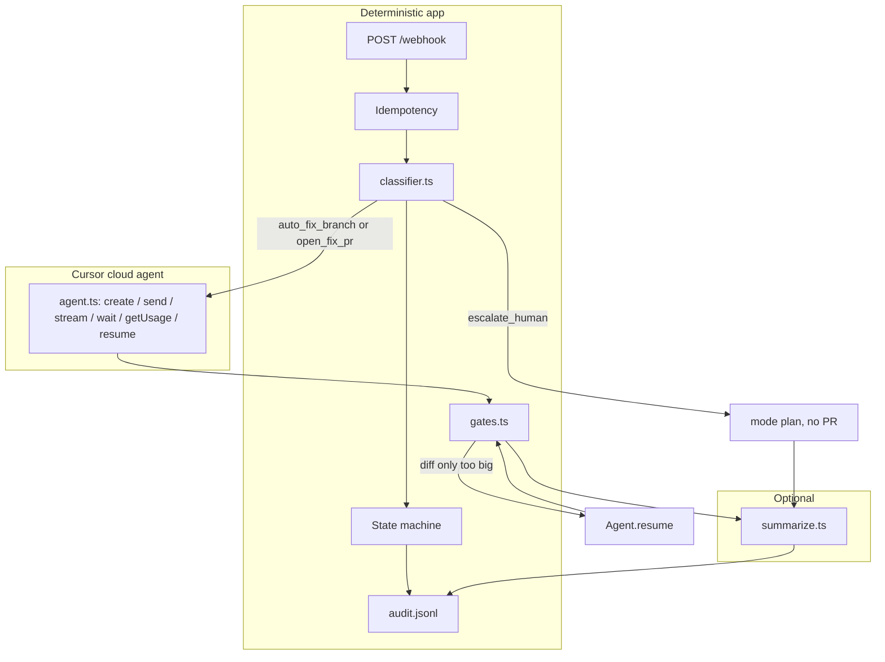

# Release Unblocker

A TypeScript service (Node 22.13+) that turns a failed GitHub Actions run, or a security finding, into a tracked incident. Deterministic code decides whether a Cursor cloud agent may edit the repo. The agent reproduces the failure, applies a minimal fix, and re-runs checks. Deterministic gates then decide whether that diff can be promoted.

The demo target is [Northstar Deal Room](https://github.com/PSchmidt23/demo-commercial-app) (`PSchmidt23/demo-commercial-app`). Its workflow is named `CI`. One job, `lint, typecheck, test`, runs `npm run lint`, `npm run typecheck`, and `npm test`, and it keeps going after an earlier step fails.

Mock mode is the default. It is what runs when `CURSOR_API_KEY` is unset, and it is what CI runs. The scripted agent speaks the same request and stream shape as the SDK path, and the fixtures use the real run ids, SHAs, log lines, and SAST payload.

## Architecture



State per incident, appended to `audit.jsonl`:

`RECEIVED → CLASSIFIED → AGENT_RUNNING → GATES → AUTO_FIXED | PR_OPEN | ESCALATED | FAILED`

`GATES` may return to `AGENT_RUNNING` once, when the only failures are the line or file limits. A diagnosis (`escalate_human`) goes `AGENT_RUNNING → ESCALATED` and does not promote anything. `FAILED` is reachable from every non-terminal state.

## The seam

| The app owns | The Cursor agent owns |
| --- | --- |
| Webhook ingestion and signature checks | Reproducing the failure on a VM |
| Idempotency (delivery id, workflow run id, finding id) | Adding a regression test only if none fails |
| Classification and the policy decision | The minimal code change |
| GitHub reads: jobs, logs, compare, check status | Re-running lint, typecheck, and test |
| Gate evaluation and the audit log | |
| The optional Grok summary | |

`src/agent.ts` is the only file that imports `@cursor/sdk`. Everything else talks to `runReleaseAgent()`. Escalated incidents launch `mode: "plan"` with `autoCreatePR: false` and a prompt that forbids edits. Cloud agents cannot drop write tools: `tools` and `disallowedTools` are local-only and throw `ConfigurationError` when combined with `cloud`. Plan mode is the supported non-writing conversation mode.

The promotion diff is the agent's commit range (`starting SHA...branch`), not the whole feature branch. A 500-line branch with an 8-line fix should still pass the 80-line gate.

## Scenarios

Northstar CI job name is `lint, typecheck, test`. The classifier uses **failed step conclusions**, not that title. A passing `npm test` step does not make scenario A a test failure, and a passing lint step does not make scenario B a lint failure.

| | Branch | Real run | What failed | Policy | Mock outcome |
| --- | --- | --- | --- | --- | --- |
| A | `ci-fail-lint-type` | [45702809861](https://github.com/PSchmidt23/demo-commercial-app/actions/runs/45702809861) | `Run npm run lint` and `Run npm run typecheck` fail. ESLint: `'randomUUID' is defined but never used` in `src/pricing/currency.ts`. tsc: `Type '{ num: bigint; den: bigint; }' is not assignable to type 'number'` in `parseRate`. `Run npm test` passes (36 tests). | `lint_type`, low, `auto_fix_branch` | `AUTO_FIXED` on the failing branch |
| B | `ci-fail-test` | [45702826376](https://github.com/PSchmidt23/demo-commercial-app/actions/runs/45702826376) | Lint and typecheck pass. Vitest: `converts the discounted USD total, then rounds half-up`, expected `91833`, received `91834`, in `src/proposals/calculator.ts`. | `test_failure`, medium, `open_fix_pr` | `PR_OPEN` |
| C | `main` | [`fixtures/findings/cve-auth-bypass.json`](https://github.com/PSchmidt23/demo-commercial-app/blob/main/fixtures/findings/cve-auth-bypass.json) | SAST-1042, rule `auth.oidc.missing-audience-bypass`, CWE-287, high, `src/auth/entra.ts:138`. `audienceAccepted` returns true when `aud` is missing. | `sast`, high, `escalate_human` | `ESCALATED`, plan-mode diagnosis, no diff |

Scenario C is not a `dependency_cve`. The file name says CVE; the payload is a first-party SAST finding. Dependency advisories (a `cve`, `GHSA-`, or package field) still map to `dependency_cve` and open a PR, unless they touch a protected path.

Protected prefixes, in `src/gates.config.ts`: `src/auth/`, `auth/`, `migrations/`, `infra/`. Any of them forces high risk and `escalate_human`.

## Models

| Role | Default | Why |
| --- | --- | --- |
| Cursor cloud agent | `composer-2.5` (`CURSOR_MODEL`) | Documented coding model for `@cursor/sdk` 1.5.0. Composer 2 is retired; the SDK reroutes `composer-2` to 2.5. A fixed id keeps a demo reproducible. `auto-smart` can change the underlying model between requests. |
| Grok summary | `grok-4.7` (`XAI_MODEL`) | Current flagship on the xAI Responses API (`https://api.x.ai/v1/responses`) as of November 2026. Structured output via `text.format` json_schema. It writes a paragraph. It never edits the repo. |

If `XAI_API_KEY` is unset, `summarize.ts` returns a template and the incident still closes.

## SDK calls verified against `@cursor/sdk` 1.5.0

Checked against the package types and [the TypeScript SDK docs](https://cursor.com/docs/sdk/typescript):

- `Agent.create(options: AgentOptions)`
- `Agent.resume(agentId, Partial<AgentOptions>)`
- `agent.send(prompt, SendOptions)`
- `run.stream()` yields `SDKMessage`
- `run.wait()` returns `RunResult`
- `agent.getUsage()` returns `AgentUsage`

Differences from a short sketch of that API:

- `model` is `{ id: string }`, not a bare string.
- `idempotencyKey` exists on **both** `Agent.create` and `agent.send`. Creation and the prompt are different operations, so this service uses `…:create` and `…:send`.
- `getUsage()` returns `{ usage, cost?, runs }`. Cost is integer cents (`chargedCents`, `rawCostCents`) and can be absent until billing settles. It is not a single dollar figure.
- `run.stream()` includes a `summary` event in addition to assistant, thinking, tool_call, status, and usage. Tool arguments are not a stable schema; the audit log stores tool name and status only.
- `tools`, `disallowedTools`, and `systemPrompt` are local agents only. Passing them with `cloud` throws `ConfigurationError`. Diagnosis uses `mode: "plan"`.
- `Run.git.branches[]` carries `{ repoUrl, branch?, prUrl? }`. There is no commit SHA on the run. Gates compare the webhook's `head_sha` with the branch the run reports.

`src/agent.ts` returns `AgentOptions` from `buildAgentCreateOptions`, so a wrong field fails `tsc`.

## Run it

```bash
npm install
npm start
```

Open http://127.0.0.1:8787. The header shows `mock` or `live`.

```bash
npm run demo -- --scenario A
npm run demo -- --scenario B
npm run demo -- --scenario C
```

The CLI posts the fixture to the server and waits. Run the same scenario again and the response is the original incident: delivery id, run id, and finding id are all dedupe keys. `rm data/audit.jsonl` clears the log. `--rerun` mints a new delivery id so you can watch a second pass without deleting the log.

Offline, without a server:

```bash
npm run demo -- --scenario A --inline
npm run demo -- --scenario B --inline --dry-run
npm run demo -- --scenario C --inline
```

`--dry-run` forces the mock even when the server has a key. A request cannot force live mode. No key means mock, always.

### Real mode

Needs a Cursor API key that can start cloud agents on the demo repo, and a GitHub token that can read Actions and pull requests.

```bash
export CURSOR_API_KEY=...
export CURSOR_MODEL=composer-2.5          # optional
export GITHUB_TOKEN=...
export GITHUB_WEBHOOK_SECRET=...          # optional; required on POST /webhook when set
export XAI_API_KEY=...                    # optional
export XAI_MODEL=grok-4.7                 # optional
npm start
npm run demo -- --scenario A
```

What real mode still does with those keys:

1. `workflow_run` payloads without an `evidence` block: the server reads failed jobs and log snippets from the Actions API.
2. The agent is created with `cloud.repos: [{ url, startingRef: head_sha }]`. `auto_fix_branch` sets `workOnCurrentBranch: true`. `open_fix_pr` sets `autoCreatePR: true`.
3. After `run.wait()`, gates compare `head_sha...branch` and poll commit status (`CI_POLL_ATTEMPTS`, default 3).
4. On a passing `open_fix_pr`, the summary is patched onto the PR body. A mock PR url is never patched.

Post the raw finding, or the envelope in `fixtures/scenario-c.json`:

```bash
curl -s -X POST http://127.0.0.1:8787/webhook?wait=1 \
  -H 'content-type: application/json' \
  --data-binary @fixtures/findings/cve-auth-bypass.json
```

`GET /api/events` is the SSE feed the dashboard uses. `GET /api/incidents` is the folded audit log.

## Gates

All of them live in `src/gates.ts`. Limits live in `src/gates.config.ts`.

- CI on the agent commit is `success`. `pending` does not pass.
- Changed lines (`additions + deletions`) ≤ 80.
- Files ≤ 4.
- No file under a protected prefix.
- No deleted `*.test.ts`, no removed `it` / `test` / `describe` title, no added `.skip` / `.only` / `xit`. A test file with no patch fails closed. A `.skip` that was already on the branch (a context line) does not.

Only a pure size failure is sent back through `Agent.resume`. A protected-path edit, a test edit, or a red CI suite escalates immediately.

## Environment

| Variable | Required | Purpose |
| --- | --- | --- |
| `CURSOR_API_KEY` | Live mode | Cursor user or service-account key. Team Admin keys are not supported by the SDK. |
| `CURSOR_MODEL` | No | Default `composer-2.5`. |
| `GITHUB_TOKEN` | Real gates and log fetch | Actions jobs, logs, compare, commit status, PR body. |
| `GITHUB_WEBHOOK_SECRET` | No | When set, `POST /webhook` requires `X-Hub-Signature-256`. |
| `XAI_API_KEY` | No | Grok summary. Unset → template. |
| `XAI_MODEL` | No | Default `grok-4.7`. |
| `PORT` / `HOST` | No | Default `8787` / `127.0.0.1`. |
| `AUDIT_PATH` | No | Default `data/audit.jsonl`. |
| `DEMO_REPO_URL` | No | Default the Northstar repo. Used when a finding omits `repo`. |
| `DRY_RUN` | No | `1` forces mock even if a Cursor key is present. |
| `CI_POLL_ATTEMPTS` / `CI_POLL_INTERVAL_MS` | No | Real-mode wait for the agent commit to go green. |
| `MOCK_STREAM_DELAY_MS` | No | Pause between scripted stream events. Tests set this to `0`. |

## Tests and CI

```bash
npm run lint
npm run typecheck
npm test
```

GitHub Actions (`.github/workflows/ci.yml`) runs those three. Tests cover the classifier (including the combined job name and the real SAST file), gates, idempotency and webhook signatures, the state machine for A/B/C, the one-shot resume when a diff is too big, and a fake SDK client that records `create` / `resume` / `send` / `stream` / `wait` / `getUsage`.

## Production gaps

These are intentional for a 45-minute walkthrough.

- **Latency and cold starts.** A cloud agent waits on VM provisioning (`status: CREATING`) before it compiles anything. The HTTP handler returns 202 unless `?wait=1`. There is no queue, no deadline, and no cancellation from the dashboard.
- **Cost caps.** `getUsage()` is recorded and shown. Nothing stops a run that crosses a budget, and cost can arrive after the incident closes.
- **Idempotency in a database.** The dedupe set is rebuilt from the JSONL file in this process. Two replicas would double-launch. A unique key on delivery id, run id, and finding id belongs in a database.
- **Secrets.** The webhook secret is one shared HMAC. There is no SSO, no RBAC, and no audit of who triggered a live run. Do not put this port on the internet as-is. `HOST` defaults to loopback.
- **Flaky tests.** A green re-run of a flaky suite would look like a fix. The gates only see the agent's commit status, not whether the same failure reproduced first.
- **Rate limits.** GitHub job-log and compare calls, and Cursor `Agent.create`, are not retried. `CursorSdkError.isRetryable` is the hook for that. CI polling is a fixed short loop; a slow Actions run escalates as `pending`.

## Small live extensions

Each of these is a local edit with a test next to it.

1. **A new gate.** Append a function to `gateList` in `src/gates.ts` and a limit in `src/gates.config.ts`. Example: reject a `package-lock.json` change, or require the diff to touch the file named in the log.
2. **A new category.** Add a row to `POLICY_BY_CATEGORY` and a detector in `detectCategory`. A Dependabot `dependency_bump` is the obvious one: medium risk, `open_fix_pr`, and a gate that the lockfile is the only non-manifest change.
3. **Slack on `ESCALATED`.** Subscribe to the in-process hub in `src/hub.ts` (the same bus as `GET /api/events`) and post the summary. The state machine does not need to know.
4. **A per-repo policy file.** Read `.release-unblocker.yml` from the GitHub contents API before `classify()`, and pass overrides into the classifier and `evaluateGates`. Keep the file in the app, not in the agent prompt, so a bad model day cannot loosen `src/auth/`.
